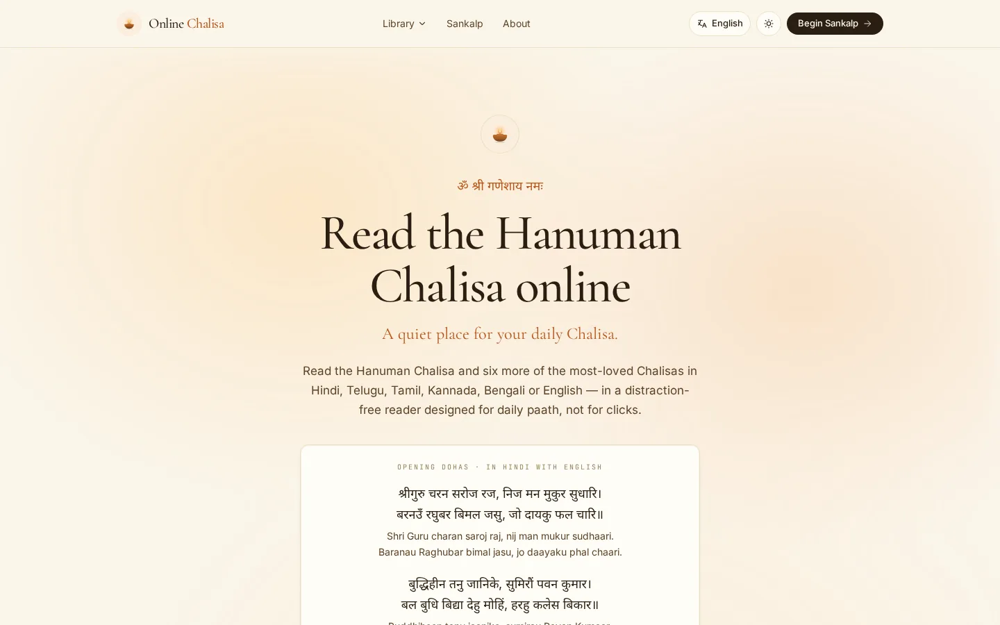
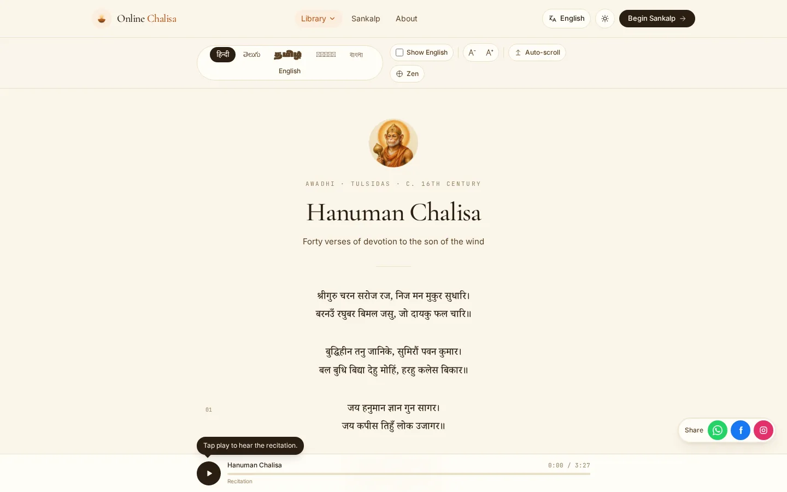
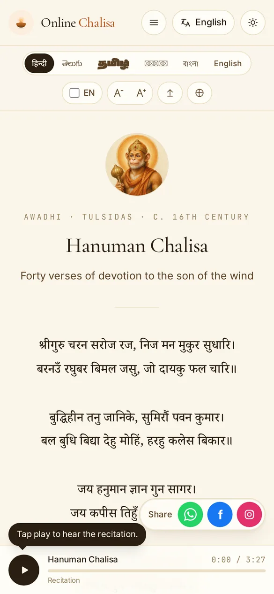

# Online Chalisa · [onlinechalisa.com](https://onlinechalisa.com)

A fast, clean reader for Hindu devotional texts (chalisas, aartis, the Bajrang Baan, the Durga Kavach and more) in six languages, with audio that follows along verse by verse.

<table><tr>
<td width="72%"><br></td>
<td width="28%"></td>
</tr><tr><td align="center"><sub>Home and the chalisa reader with the audio player</sub></td><td align="center"><sub>Mobile</sub></td></tr></table>

## Features
- **7 chalisas and 8 paath texts** (Hanuman, Durga, Ganesh, Laxmi, Saraswati, Shani and Shiv chalisas; aartis, Bajrang Baan, Durga Kavach, Sankat Mochan Hanuman Ashtak, and more) stored as structured JSON content.
- **6 locales**: English, Hindi, Bengali, Telugu, Tamil and Kannada, using Astro i18n routing. English sits at `/`, every other language has a prefix, and untranslated pages fall back to the English page instead of redirecting.
- **Offline script transliteration** from Devanagari to Telugu, Tamil, Kannada, Bengali and IAST. It's mapped by hand and has no runtime dependencies, and it handles cases like Tamil's missing consonants.
- **Verse-synced audio**: a Node script makes one ElevenLabs clip per verse, caches it, joins the clips with ffmpeg and writes per-verse timestamps that the reader uses to highlight along.
- **Reader controls**, a **daily reading streak tracker**, **WhatsApp sharing** and a sankalp page.
- **SEO**: a generated sitemap, per-page Open Graph images from `scripts/gen-og.mjs`, and a custom 404 page.
- **SSR on Cloudflare Workers** using the Astro Cloudflare adapter, with KV-backed sessions and custom domains only.

## Tech stack
Astro 7 · TypeScript · Tailwind CSS 4 (Vite plugin) · Cloudflare Workers + KV (Wrangler) · ElevenLabs TTS · ffmpeg

## Project structure
```
src/
  components/    AudioPlayer, ReaderControls, LanguageSwitcher, StreakTracker, ShareWhatsApp, …
  content/       chalisas/*.json, paath/*.json
  i18n/          locale config and UI strings
  lib/           transliterate.ts, romanize.ts, library.ts, …
  pages/         index, chalisa/[slug], paath/[slug], sitemap.xml.ts, about, privacy, terms
scripts/         gen-recitation.mjs (audio), gen-og.mjs (OG images)
```

## Run locally
```bash
npm install
npm run dev        # http://localhost:4321
npm run build
npm run deploy     # astro build && wrangler deploy (needs Cloudflare access)
npm run audio -- hanuman   # needs ELEVENLABS_API_KEY / ELEVENLABS_VOICE_ID in .env and ffmpeg on PATH
```

## Credits
Built by **Akhilendra Singh** and co-author **Aman Sharma** ([@asaman94](https://github.com/asaman94)).
